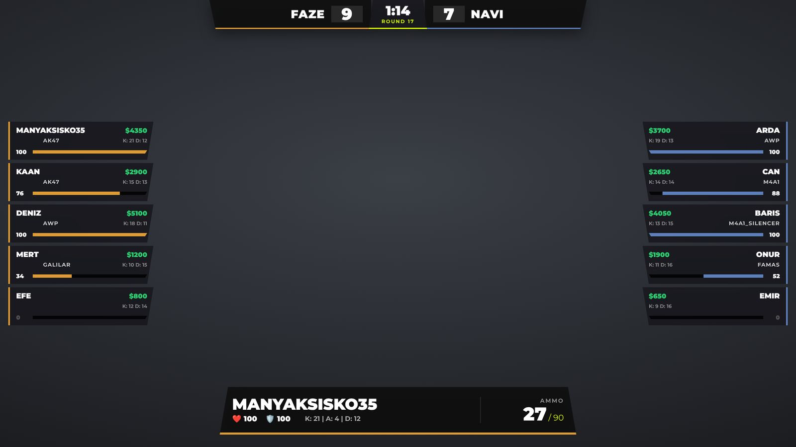

# CS2 Major HUD

A Major-style broadcast overlay for Counter-Strike 2. It shows both teams' health, money, weapons, grenades and K/D, the spectated player's stats, a killfeed and a bomb timer, all driven by live match data from the game.



## How it works

1. **Game State Integration (GSI).** CS2 can send match data to an address of your choice. `gamestate_integration_manyak.cfg` tells the game to POST JSON to `http://127.0.0.1:3000` every 0.1 seconds.
2. **Python server (`main.py`).** A small Flask server receives that JSON and boils it down to what the overlay needs: scores, round, phase and time left, bomb state, and for each player their name, health, money, main weapon, grenades and kills/deaths. It serves the result at `http://127.0.0.1:3000/canli_veri`.
3. **Overlay (`index.html`).** A 1920×1080 transparent page that polls the server 10 times a second and only updates the parts of the screen whose values changed, so nothing flickers on stream.

## Features

- **Team panels:** health bar, money, main weapon icon, grenades and K/D for all ten players. Health bars turn red under 30 HP.
- **Spectated player:** name, health, armor, ammo and K/A/D of the player you are watching.
- **Killfeed:** GSI doesn't report kills directly, so the overlay compares each player's kills and deaths with the previous update to work out who killed whom, and shows it with the weapon icon for five seconds.
- **Bomb timer:** when the bomb is planted, the round timer turns into a 40-second bomb bar. During a defuse the bar turns white and runs over 5 or 10 seconds depending on whether the player has a kit. It also shows BOOM or DEFUSED at the end of the round.

## Built with

Python, Flask, Flask-CORS, HTML, CSS and JavaScript.

## Getting started

1. Copy `gamestate_integration_manyak.cfg` into your CS2 cfg folder:
   `...\Steam\steamapps\common\Counter-Strike Global Offensive\game\csgo\cfg`
2. Install the Python packages:
   ```bash
   pip install -r requirements.txt
   ```
3. Start the server:
   ```bash
   python main.py
   ```
4. Open `index.html` in a browser, or add it to OBS as a **Browser Source** (1920×1080) with a transparent background.
5. Start or spectate a match in CS2. The HUD fills in as soon as the game starts sending data.

Team names and logos are set directly in `index.html`; change them for your own match.

## Türkçe

Counter-Strike 2 için Major turnuvalarındaki gibi bir yayın arayüzü. Oyunun Game State Integration özelliğiyle gelen veriyi Python ile yazdığım bir Flask sunucusu sadeleştiriyor; HTML ve JavaScript ile yazdığım arayüz de saniyede 10 kez bu sunucudan veri çekip takımları, izlenen oyuncuyu, killfeed'i ve bomba sayacını canlı gösteriyor. Kurulum için cfg dosyasını CS2'nin cfg klasörüne kopyala, `pip install -r requirements.txt` ve `python main.py` komutlarını çalıştır, `index.html`'i OBS'e tarayıcı kaynağı olarak ekle.

The screenshot uses made-up sample data.

Made by [Hasan Alp Güngör](https://hasanalpgungor.com/en) · [Project page](https://hasanalpgungor.com/en/projects/cs2-major-hud)
